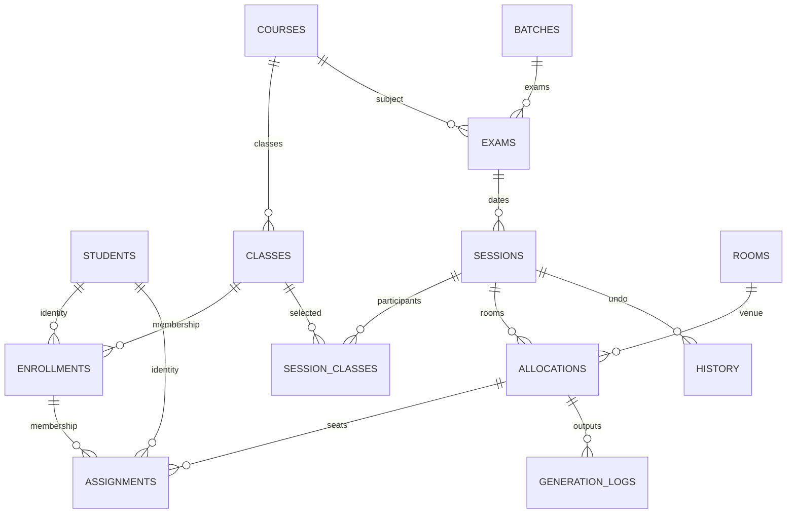

# Phase 1：實際附件與架構分析

## 學生名單

四份名單均有 A:J 十欄。表頭：A 帳號、B 姓名、C 英文姓名、D 課程、E 班級、F 考勤成績、G 原始成績、H 最終成績、I 特殊情形、J 備註。後五欄非本系統的身份或修讀欄位，不匯入成績或特殊情形。

匯總 Sheet 表頭在第 9 行、資料從第 10 行開始；獨立班級 Sheet 表頭在第 8 行、資料從第 9 行開始。底部有「教師簽字」和日期，不是學生。

科目中英文資訊由原名單的 B3（公司金融 - BAE305-班級）、I6（BAE305）、B4（江宇）、B5（學位課程）識別。每份原名單均未提供獨立英文科名，因此匯入不猜測該名稱；使用者在科目管理補齊。兩份官方出席表已提供 Corporate Finance，可在資料建立時使用。

| 檔案 | Sheet | 真實人數 | 預設 |
|---|---|---:|---|
| 3D | 匯總 / A / D | 30 / 1 / 29 | D |
| 3E | 匯總 / E | 28 / 28 | E |
| 3F | 匯總 / A / E / F | 34 / 1 / 1 / 32 | F |
| 3G | 匯總 / B / E / G | 35 / 1 / 1 / 33 | G |

每個 Sheet 內未發現重複學號，但匯總和獨立 Sheet 描述相同修讀記錄，不可同時合併。D/E/F/G 選取結果共 122 個不同學生。3F 的 E、3G 的 E 等非檔名班級，仍顯示並可由使用者選取；不自行隱藏或納入。

## 官方模板

兩檔均有 Attendance、Seat Plan，資料從第 18 行開始。

| 區域 | 儲存格 |
|---|---|
| 大學中文 / 英文 | A1 / A2，A:G 合併 |
| 課程中文 / 英文 | A3 / A4，A:G 合併 |
| 學年學期考試標題中英 | A5 / A6，A:G 合併 |
| 科目標籤 / 科名 | A7 / A8，A:G 合併 |
| Intake / 教師 | D10 / E10:G10 |
| 考場 / 日期 | D12 / G12 |
| 考生數 / 時間 | D14 / G14 |
| 簽到說明 | C15:G15（Seat Plan 應清除） |
| 中文 / 英文欄名 | 第 16 / 17 行 |
| 序號 / 座號 / 學號 | A / B / C |
| Attendance 中文 / 英文 | D / E |
| Attendance 簽到 / 簽走時間 | F / G |
| Seat Plan 中文 / 英文 | D:E / F:G 合併 |

Attendance 合併範圍含 A1:G1 至 A8:G8、A9:C9、A11:C11、A13:C13、E9:F9、E10:G10、E11:F11、E13:F13、C15:G15、D16:E16、D17:E17。Seat Plan 使用 D16:G16、D17:G17，並對每條學生行分別合併 D:E 和 F:G。

原 A、B 欄寬 5.625，C 18.625，D 12.625，E 24.625，F 18.625；G 原依預設欄寬。本工具保留既有欄寬並為 G 明確設定 20，避免簽走時間或英文名截斷。原多數行高 16.5、學生行 15；姓名改為要求的 12 pt 後採至少 22 pt，长姓名自動增加。

原使用 Times New Roman、細明體、新細明體，字號 7/8/11/12；本工具保留表頭風格，按需求將學生姓名改為中文標楷體 12、英文 Times New Roman 12，序號、座號及學號 Times New Roman 12。

原打印區域及標題重複行未明確設定，A4 直向、比例 83%、左右邊距約 0.709 英吋、上下約 0.748 英吋。原無手動分頁。本工具設定實際打印區域、重複 1:17 行、單頁寬／不限頁高、保守手動分頁、頁碼；原頁邊距保留。

G2207 Attendance 有 63 人，G2209 有 64 人；COUNTA 分別引用 C18:C81 和 C18:C82，尾端包含空白行。本工具把考生數直接設定為實際記錄數。日期原為 Excel datetime，輸出使用真正日期值及 `yyyy-mm-dd`；時間輸出 HH:MM-HH:MM。

**發現的模板缺陷**：G2209 Seat Plan C80/D80/F80 與 C81/D81/F81 均引用 Attendance 第 81 行。此模板會漏掉第 80 行的學生、重複第 81 行，不能原樣沿用。Seat Plan 也保留了只適用 Attendance 的簽到說明。本工具分開渲染兩種版面，共用同一份確定次序的資料，移除全部公式依賴與簽到說明。原「Abstent」拼字修正為「Absent」。

詳盡合併範圍、欄寬、各行行高、表頭字型、對齊、邊框、日期格式及頁面參數記錄於 `resources/excel-analysis.json`；該報告不含學生姓名或學號。`official_template.xlsx` 僅保留表頭及去值的樣式示範行，無學生資料。

## SQLite 與 GUI

身份及修讀使用 UUID，學號為唯一身份鍵但不是外鍵。座號獨立於 position，鎖定、特殊安排和備註屬於 assignment。重新匯入的移除只停用 enrollment，不刪 assignment；在輸出前顯示待處理錯誤。所有編排 mutation 交易保存 before/after 快照，可跨重啟復原／重做；重新執行其他操作時清除後續 redo 分支。

Qt 主視窗採九頁導航與共用場次選取器；ClassCards 使用 QDrag/QMimeData，RoomCards 接受 Qt drop event；SeatTree 使用 Qt InternalMove 並以 drop 後 order 訊號寫回服務層。容量不足不自動拆分，使用者在勾選對話框確認特定學生。UI 不直接負責座號計算或 Excel 版面。
